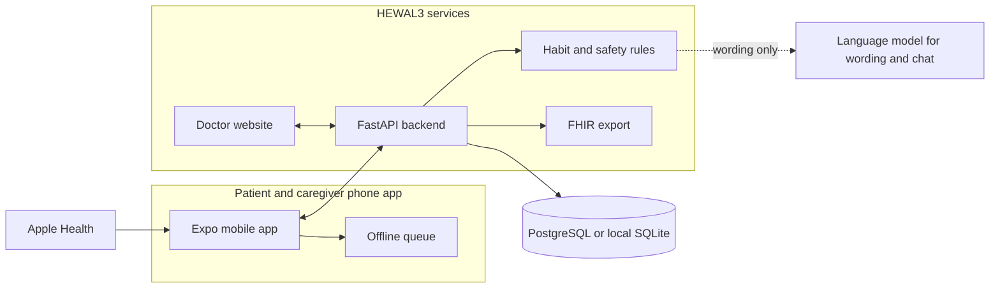

<div align="center">

# HEWAL3

### Keeping people on track with their health, and bringing them back gently when they drift.

**A health platform prototype for patients, caregivers, and clinicians.** The product is in the prototype phase; UAE hosting and deployment are pending.

[](https://youtu.be/28GKjPjZDKI)

[Watch the demo on YouTube](https://youtu.be/28GKjPjZDKI)


</div>

> **Status: prototype.** HEWAL3 includes a phone app for patients and caregivers, a doctor website, and a shared API. UAE hosting and deployment are still pending. The current demo and hosted services should not be treated as a UAE production or clinically validated service.

## Demo

Click the thumbnail above to watch the latest demo video.

## What the prototype includes

- Habit plans and personalised goals for activity, movement breaks, sleep, water, medicines, meals, and weight.
- Lapse detection and recovery prompts, with configurable outreach preferences, quiet hours, weekly limits, and follow-up measurement.
- Patient and caregiver phone app, plus a clinician-facing website with patient records, consultations, messages, appointments, documents, and impact reporting.
- Apple Health data support for selected health metrics.
- UAE/Gulf-oriented settings, including an estimated Ramadan calendar, approximate prayer-time-aware messaging, seasonal heat guidance, UAE emergency numbers, Arabic RTL layout, and French text.
- Emergency-flow prototype, guest reviewer mode with labelled demo data, consent controls, access log, data export and erase.
- FHIR R4 export and a public responsible-AI system card.
- **Health record** (patient app and doctor website): allergies, laboratory results, imaging reports, vaccinations, insurance details, and hospital check-in and check-out with a discharge summary. Patients add allergies, vaccines and insurance; doctors add results, imaging and visits. Changes reach the other side live.
- **Primary care card:** the patient's chosen doctor, next appointment and last visit, with booking and messaging in one place.
- **Family profiles:** a child's, parent's or partner's allergies, conditions, vaccines, results and visits, private to the guardian.
- **Prevention:** age-and-sex screening reminders, a published type 2 diabetes risk questionnaire (FINDRISC), and a heat check with advice written for the person's own conditions.
- **Workplace heat safety:** an occupational-health doctor records site temperature and humidity (by hand or from a sensor); staff who joined with a code are warned when the heat reaches danger. The employer side shows counts only, and never under 5.
- **Sharing between clinics:** the patient gives another clinic a short, time-limited code; the clinic receives the shared record as an HL7 FHIR bundle, every use is logged for the patient, and the patient can cancel it.
- **Working settings:** notification switches that change real behaviour, and a privacy centre that shows who accessed the record (caregivers and doctors).

These are prototype capabilities, not a claim of clinical validation or readiness for clinical use.

## Architecture

This diagram uses GitHub-supported Mermaid syntax and plain-text node labels for reliable rendering.



AI is used for wording and chat; product decisions and safety rules are implemented as ordinary application logic. Health data integration and emergency features require platform permissions and configuration.

## Who it is for

The prototype has five audience segments: people with long-term conditions, desk-based workers, adults under 40, adults 40–59, and adults aged 60 and over. Segments affect default goals and wording, not safety rules.

## Gulf setting

The prototype includes Ghana and UAE region settings. UAE week conventions, estimated Ramadan dates, approximate Abu Dhabi prayer times, seasonal heat advice, and UAE emergency numbers are included. Calendar and prayer-time values are estimates and should be checked locally.

## Responsible AI, safety, and validation

- AI is limited to wording and chat; the system card describes intended use and limitations.
- AI inputs are de-identified, and consent controls govern access to patient information.
- Emergency handling defaults to simulation; it is not a substitute for emergency services.
- `docs/VALIDATION.md` reports rule verification by simulation. This is not clinical validation.
- UAE deployment, local review, and clinical validation remain outstanding.
- Privacy and security controls follow HIPAA-style technical safeguards (unique accounts, role-based access, an access log that includes doctors, automatic sign-out, consent, export and erase). **HEWAL3 is not HIPAA compliant or certified.** `docs/COMPLIANCE.md` lists what is in place and the gaps before a real pilot, including signed agreements with hosting providers and UAE data residency.

## Technology

- **Mobile app:** Expo / React Native (`front-sdk58/`)
- **Doctor website:** React, Vite, TypeScript (`doctor-web/`)
- **API:** FastAPI (`back/`)
- **Data:** PostgreSQL in hosted configurations; SQLite for local development
- **Language model:** optional, used for wording and chat only

## Run locally

### Backend

```bash
cd back
python -m venv .venv
# Activate the virtual environment, then:
pip install -r requirements.txt
uvicorn app.main:app --reload --host 0.0.0.0
```

### Phone app

```bash
cd front-sdk58
npm install
npx expo start
```

For a physical iPhone, configure the API base URL and the required iOS development permissions. Apple Health access requires a compatible iOS build and user authorization.

**Android APK for reviewers.** `front-sdk58/eas.json` has a `preview-android` profile that builds an installable `.apk` pointed at the hosted API:

```bash
cd front-sdk58
npx eas-cli build --platform android --profile preview-android
```

Android has no Apple Health, so health-data screens show their empty states there. Watch Bluetooth, push alerts and video calls are not set up for Android in this build.

### Doctor website

```bash
cd doctor-web
npm install
npm run dev
```

See the project setup guides for environment variables and platform-specific requirements.

### API documentation

The interactive API reference is at `/docs` (and `/redoc`) on the backend. In production it is off by default; set `ENABLE_DOCS=1` on the server to show it, for example at `https://imaginehewal3-26-main.onrender.com/docs`.

## Tests and verification

```bash
cd back
python -m pytest tests -q
python scripts/validate_rules.py
python scripts/load_test.py http://localhost:8000 --users 20 --seconds 15
```

```bash
cd front-sdk58
npm test
npx tsc --noEmit
```

The simulation and load-test results are engineering checks, not clinical evidence.

## Repository map

- `back/` — FastAPI backend, services, scripts, and tests
- `front-sdk58/` — patient and caregiver phone app
- `doctor-web/` — clinician website
- `iot/` — watch and Bluetooth wearable bridge
- `docs/` — architecture, validation, pilot, security, and setup documentation

## Documentation

- [Architecture](imaginehewal3-26-main/docs/ARCHITECTURE.md)
- [Rule validation](imaginehewal3-26-main/docs/VALIDATION.md)
- [Challenge build notes](imaginehewal3-26-main/docs/BUILT_DURING_THE_CHALLENGE.md)
- [Assessment map](imaginehewal3-26-main/docs/ASSESSMENT_MAP.md)
- [Pilot and commercial plan](imaginehewal3-26-main/docs/PILOT_AND_COMMERCIAL.md)
- [Doctor portal specification](imaginehewal3-26-main/docs/DOCTOR_PORTAL_SPEC.md)
- [Design and security](imaginehewal3-26-main/docs/DESIGN_AND_SECURITY.md)
- [Mobile development setup](imaginehewal3-26-main/docs/MOBILE_DEV_SETUP.md)
- [Privacy, security and compliance status](imaginehewal3-26-main/docs/COMPLIANCE.md)
- [Hackathon submission text](imaginehewal3-26-main/docs/HACKATHON_SUBMISSION.md)
- [Huawei Health setup](imaginehewal3-26-main/docs/HUAWEI_HEALTH_SETUP.md)

## Roadmap and limitations

- UAE hosting and deployment are pending.
- Clinical validation and local clinical/regulatory review are pending.
- FHIR export is available; importing records from clinic systems is future work.
- Ramadan and prayer-time data are estimates.
- The current service is a prototype and must not be represented as a UAE production deployment.

## License

Released under the [MIT License](LICENSE). HEWAL3 supports care and is not a medical device.
