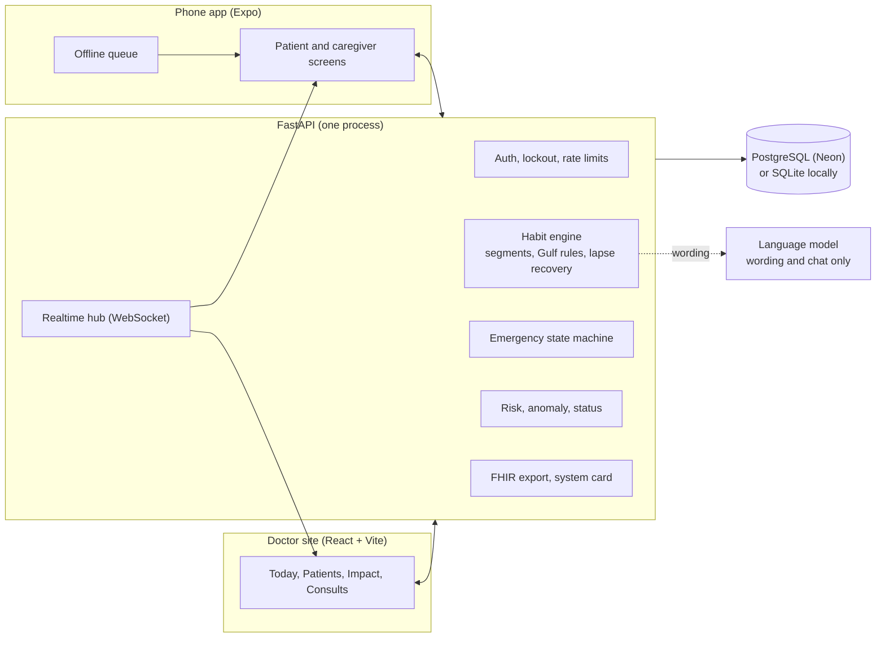

<div align="center">

# HEWAL3

### Keeping people on track with their health, and bringing them back gently when they drift.

A complete, working health platform for people with long-term conditions, desk-based workers, and young, middle-aged and older adults. A phone app for patients and caregivers, a website for doctors, and one API behind both.

[](https://youtu.be/OZlOT4_6Sio)
[](https://imaginehewal3-26-main.onrender.com/ping)
[](https://imaginehewal3-26-main.onrender.com/doctor/)
[](https://imaginehewal3-26-main.onrender.com/system/card)


</div>

> **HEWAL3 is live and fully working.** Patients and caregivers use the phone app, doctors use the website, and both run on one API deployed on Render. Watch the [care agent story](https://imaginehewal3-26-main.onrender.com/doctor/#/story) with no sign-in, or open the [doctor site](https://imaginehewal3-26-main.onrender.com/doctor/) and choose **Continue as Reviewer**, or choose it in the app. HEWAL3 supports care and does not diagnose; it is not a medical device.
>
> **Watch the demo:** [https://youtu.be/OZlOT4_6Sio](https://youtu.be/OZlOT4_6Sio)

---

## Contents
1. [Demo video](#demo-video)
2. [The problem](#the-problem)
2. [What it does](#what-it-does)
3. [Who it is for](#who-it-is-for)
4. [Gulf and Abu Dhabi setting](#gulf-and-abu-dhabi-setting)
5. [Safety and responsible AI](#safety-and-responsible-ai)
6. [Architecture](#architecture)
7. [Repository layout](#repository-layout)
8. [Run it locally](#run-it-locally)
9. [Configuration](#configuration)
10. [Tests and evidence](#tests-and-evidence)
11. [Deploy](#deploy)
12. [Documents](#documents)
13. [Scope and roadmap](#scope-and-roadmap)

---

## Demo video

[](https://youtu.be/OZlOT4_6Sio)

Watch the full demo on YouTube: [https://youtu.be/OZlOT4_6Sio](https://youtu.be/OZlOT4_6Sio)

---

## The problem
Health programmes lose most people soon after they start. When someone goes quiet, most systems either say nothing or send the same reminder to everyone. Nobody on the care team sees it happening.

HEWAL3 notices a lapse (three or more days without a check-in), reaches the person in a way that fits their life, shrinks the next step so it is easy to restart, and measures whether that worked.

## What it does

| Area | What you get |
|---|---|
| **Habit system** | Daily plans for activity, movement breaks, sleep, water, medicines, food and weight. Targets start from the person's own baseline and grow at a pace that suits their group. Techniques (such as tiny steps or "if-then" plans) are chosen with Thompson sampling, so what works for the person is used more often. |
| **Care agent** | A visible loop that runs by itself: it **senses** check-ins, readings and the person's own clock and week, **decides** with written rules, **acts** with one fitted message and a smaller step, **hands off** to a clinician only for a very high reading or a long silence in someone with a condition, and **measures** whether the person came back. Every pass keeps a trace the person can read in the app (Habits, Today, "Your care agent") and the doctor can review on the Care agent page. Try the public story at `/doctor/#/story`. |
| **Lapse recovery** | Detects a lapse, picks the channel and time the person allowed, sends one short, fitted message, shrinks the step, and records whether a check-in followed within 48 hours. If messages go unanswered it moves from push to a quiet in-app note, then to a supporter the person chose, then stops. |
| **Vitals and risk** | Blood pressure, heart rate, oxygen, weight, sleep and steps from Apple Health, with one shared definition of patient status for all three roles. A repeated reading is required before a blood-pressure alert, which cut false alarms in simulation (see `docs/VALIDATION.md`). |
| **Emergency** | A state machine: confirm, short grace period, alert caregivers twice, then escalate. Live location can be shared. Defaults to **simulate** mode so it can never reach real emergency services by accident. |
| **Medicines** | Schedules, reminders on the phone, and adherence counted only over doses that were due. |
| **Meals** | A Ghanaian food database, meal photo matching, and calorie and macro tracking. |
| **Assistant** | A chat assistant with an offline fallback. Emergency wording is answered with fixed text before any model is called. |
| **Caregivers** | Approved caregivers see alerts, tasks, appointments and a patient's vitals, and can message them. |
| **Doctor site** | Today, Schedule, Patients, Messages, Appointments, Documents, Panel health, Impact and Emergencies. Patient pages with charts, consultation notes, prescriptions, signed documents with a public check code, video consults, habit progress (only with the patient's consent), and an **HL7 FHIR R4** export per patient. |
| **Impact page** | Retention at day 7, 30 and 90, persistence, recovery after a lapse and how fast, whether messages worked, and fairness across audience, gender, age band, language, mobility, work pattern and region. Groups under 5 people are hidden. A gap of 15 points or more is flagged. |
| **Real time** | One WebSocket channel pushes vitals, alerts, messages and calls to phones and the doctor site. |
| **Languages** | English, French and Arabic (right to left, with a restart prompt when the direction changes). |
| **Accessibility** | Dark and high-contrast modes, text size, colour-blind help, read-aloud and larger tap areas, applied across every screen. |
| **Privacy centre** | Consent switches, an access log the patient can read, one-tap data export and erase. |
| **Guest sandbox** | Try the app with no sign-up ("Continue as Reviewer"), on clearly labelled demo data. |

## Who it is for
The habit system is not limited to one condition. Each person has an **audience segment**, suggested from age, conditions and work pattern, and changeable by the user.

| Segment | Suggested when | What changes |
|---|---|---|
| Long-term condition | Has a recorded condition | Health-driven order of recommendations; steady pace |
| Desk-based | Work pattern is desk | Movement breaks per workday; reached during working hours |
| Under 40 | Age below 40 | Faster growth of targets |
| 40 to 59 | Age 40 to 59 | Balanced defaults |
| 60 and over | Age 60 or more | Slower growth, gentler wording |

A segment changes ordering, default goals, pace, wording and send window. **It never changes a safety rule.**

## Gulf and Abu Dhabi setting
Regions `gh` (Ghana) and `ae` (UAE) are supported.

- **Week:** UAE weekend is Saturday and Sunday with a short Friday.
- **Ramadan:** a tabular Islamic calendar (can be off by one day, labelled as an estimate) with a later send window.
- **Prayer times:** approximate Abu Dhabi times, used only to avoid messaging at those moments. The person can switch this off.
- **Heat:** seasonal advice for outdoor activity (by season, not live weather).
- **Emergency numbers:** UAE ambulance 998, police 999, fire 997 (Ghana 112), returned by `/emergency/config`.
- **Arabic:** full right-to-left layout.

## Safety and responsible AI
The public page `GET /system/card` states this in one place.

- **AI is used for wording and chat only.** Every decision rule (status, alerts, targets, lapse detection) is ordinary, tested code.
- A **very high blood-pressure reading** (180/120 or above) or an open emergency holds the step size and points to a clinician.
- Emergency wording gets a **fixed answer before any model** runs.
- **Consent is enforced in the API.** The doctor sees habit data only when the patient allows it. No endpoint returns another person's individual behaviour data without that person's consent.
- The person controls **outreach**: quiet hours, weekly cap, channel and an off switch.
- Inputs to AI are **de-identified** (age and conditions only).
- **No secrets in code.** In production the server refuses to start without a secret key, and API docs are off.
- Rule behaviour under noise is measured by simulation, with sensitivity, specificity and intervals, in `docs/VALIDATION.md`. It is **verification, not clinical validation**.
- Health data is never invented. A missing value shows as empty, not as a placeholder. The only sample data is the labelled guest sandbox and the demo cohort.

## Architecture



More detail in [`docs/ARCHITECTURE.md`](docs/ARCHITECTURE.md).

## Repository layout

```
back/            FastAPI backend, models, services, scripts, tests
  app/routers/     API routes (habits, doctor portal, emergency, FHIR, ...)
  app/services/    audience, gulf, behavior engine, reengagement, impact
  scripts/         seeds, load test, rule verification
  tests/           automated tests
front-sdk58/     Expo SDK 58 phone app (patient and caregiver), English, French, Arabic
doctor-web/      Doctor website (React 18, Vite, TypeScript)
front/           Earlier version of the app, kept for reference
iot/             Watch bridge for Bluetooth wearables
docs/            Architecture, validation, pilot plan, assessment map, setup guides
```

The doctor site builds into `back/app/static/doctor/` and is served by the API at `/doctor/`.

## Run it locally

### Backend
```powershell
cd back
python -m venv venv
.\venv\Scripts\Activate.ps1
pip install -r requirements.txt
copy .env.example .env      # then fill in the values you need
uvicorn app.main:app --reload --host 0.0.0.0
```
With no `DATABASE_URL`, it uses local SQLite and creates tables on start. Interactive API docs are at `http://localhost:8000/docs` in development.

### Phone app
```powershell
cd front-sdk58
npm install
copy .env.example .env      # set EXPO_PUBLIC_BASE_URL
npx expo start
```
On a real phone you cannot use `localhost`. Use your computer's network address (see `docs/MOBILE_DEV_SETUP.md`) or the deployed API. Apple Health, calls and push notifications need an iOS development build, not Expo Go.

### Doctor site
```powershell
cd doctor-web
npm install
npm run dev                 # development server
npm run build               # builds into back/app/static/doctor
```

### Demo data
```powershell
cd back
py scripts/seed_doctor_cohort.py        # demo doctor and patients (development only)
py scripts/seed_behavior_cohort.py      # habit and lapse history across audiences
```
Demo records are labelled "(demo)" and are never counted as real outcomes. The scripts write to whatever `DATABASE_URL` points at, so check it first.

## Configuration
All secrets live in `.env` (never committed). See `back/.env.example` and `front-sdk58/.env.example`.

| Variable | Purpose |
|---|---|
| `ENVIRONMENT` | `development` or `production`. Production requires a secret key and turns off `/docs` and demo seeding. |
| `SECRET_KEY` | Signs login tokens. |
| `DATABASE_URL` | PostgreSQL connection string. Empty means local SQLite. |
| `BASE_URL`, `FRONTEND_URL` | Public address of this API, used in email links. |
| `SENDGRID_API_KEY`, `FROM_EMAIL` | Email (verification, reset, codes). |
| `GEMINI_API`, `ANTHROPIC_API_KEY` | Language model for wording and chat. Optional; the product works without them. |
| `CLOUDINARY_*` | Profile and food images. Optional. |
| `INFOBIP_*` | SMS for emergencies. Optional; without it the text is logged. |
| `GOOGLE_*` | Google sign-in. Optional. |
| `EMERGENCY_DISPATCH_MODE` | `simulate` (default) or `live`. Use `live` only for a supervised pilot. |
| `EXPO_PUBLIC_BASE_URL` | (app) address of the API. |

## Tests and evidence
```powershell
cd back
py -m pytest tests -q                        # backend tests
py scripts/validate_rules.py                 # rule verification, rewrites docs/VALIDATION.md
py scripts/load_test.py http://localhost:8000 --users 20 --seconds 15

cd ../front-sdk58
npm test                                     # app tests
npx tsc --noEmit                             # type check
```
- Measured load on one local process: 86 requests per second with 0 errors (20 users, 15 seconds). A gentle probe of the live service: 0 errors. Details and limits are in `docs/ASSESSMENT_MAP.md`.
- One backend test (daily tip and doctor brief in `test_ai`) can fail when run together with the others but passes alone.

## Deploy
- **API and doctor site:** Render (Python 3.11.9). Set the environment variables above. The doctor site is served by the API at `/doctor/`.
- **Doctor site on Vercel (optional):** `doctor-web/vercel.json` sets the Vite build and rewrites API paths to Render. Vercel cannot proxy the WebSocket, so the `/doctor/` route on Render is preferred.
- **Phone app:** Expo and EAS (`front-sdk58/eas.json`).
- Free-tier hosting sleeps. The first request after idle can take about a minute.

## Documents
| File | Purpose |
|---|---|
| [`docs/ASSESSMENT_MAP.md`](docs/ASSESSMENT_MAP.md) | Each assessment criterion, the evidence and how to check it |
| [`docs/PILOT_AND_COMMERCIAL.md`](docs/PILOT_AND_COMMERCIAL.md) | 12-week pilot design, measures, compliance gaps, business model |
| [`docs/VALIDATION.md`](docs/VALIDATION.md) | Rule verification by simulation |
| [`docs/ARCHITECTURE.md`](docs/ARCHITECTURE.md) | System design and emergency flow |
| [`docs/DOCTOR_PORTAL_SPEC.md`](docs/DOCTOR_PORTAL_SPEC.md) | Doctor site specification |
| [`docs/DESIGN_AND_SECURITY.md`](docs/DESIGN_AND_SECURITY.md) | Design and security notes |
| [`docs/HACKATHON_SUBMISSION.md`](docs/HACKATHON_SUBMISSION.md) | Challenge submission text |
| [`docs/MOBILE_DEV_SETUP.md`](docs/MOBILE_DEV_SETUP.md) | Running the app on a real phone |

Some older files in `docs/` describe earlier work and may mention services we no longer use.

## Scope and roadmap
What is in place today is described above and runs on the live service. These are the points to know, and what comes next:

- **Hosting:** the live service runs in the United States on free-tier hosting, so the first request after a long idle can take about a minute. A UAE region and paid hosting are the next step for a UAE deployment.
- **Compliance:** the product supports care and is not a medical device. A deployment with a UAE partner will go through its own data-protection and health-authority review first.
- **Scaling:** the API is stateless. The realtime hub and background worker run in one process today; a shared message broker and job queue take it beyond one instance.
- **Languages:** English, French and Arabic are built in. Clinician review of the French and Arabic text is planned. Further local languages are on the roadmap.
- **Estimates are labelled:** Ramadan dates and prayer times are calculated estimates and the app says so.
- **Interoperability:** FHIR R4 export is live. Receiving records from a clinic system is next.
- **Impact numbers:** the Impact page measures from real use. The seeded cohort and the guest sandbox are labelled "(demo)" and are never counted as results.

## Contributing
Work on a branch and open a pull request. Do not commit `.env` files or anything under `private/`.
