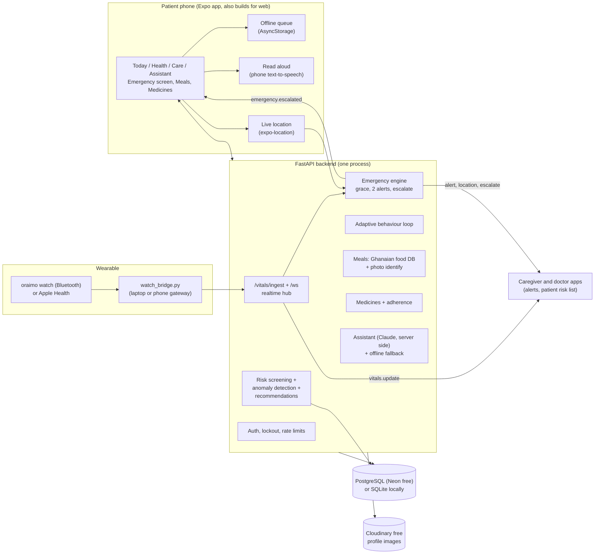

# HEWAL3 architecture (local and free stack)

Everything below runs with **no Azure and no paid service**. Cloud hosting is a later decision: each box has a cloud equivalent listed at the end, and the code does not change when you move.

## Your two questions

1. **Are we making our own watches?** No. Building hardware is outside the scope and budget. HEWAL3 reads commodity watches: a Bluetooth bridge for the oraimo watch (`iot/watch_bridge.py`, works only if the watch exposes the standard heart-rate service, which `probe` checks), Apple Health on iPhone, and simulated readings for demos. The pitch is the software and the care loop around any wearable. If funded, the pilot can bundle an affordable certified watch.
2. **App or website?** Both from one codebase. The patient and caregiver experience is a mobile app (Expo, iOS and Android). The same code builds a web version for the doctor dashboard and for demos on a laptop.

## Emergency Auto-Response (the new feature in the brief)

1. **Detect.** A critical watch reading (heart rate 150 or above or 35 or below, blood oxygen under 88%, blood pressure 180/120 or above), confirmed by two readings in a row, or the patient presses SOS.
2. **Grace period.** 15 s (5 s for manual SOS). The phone shows a countdown and "I'm OK, cancel", so a sensor glitch does not alert anyone.
3. **Caregivers, alert 1 and alert 2.** Full-screen alert in the caregiver's app, in-app notification and SMS (SMS needs an Infobip key; without it the text is logged). 60 s to acknowledge between alerts. Any approved caregiver can acknowledge, which stops escalation.
4. **Escalate.** If nobody acknowledged, the patient's phone is told to dial the national emergency number, live location is shared with caregivers and emergency contacts, and every step is logged with a timeline.

**What is real and what is simulated.** The whole state machine, the alerts, the timers, the location sharing and the audit trail are real and tested. A server cannot dial 112 by itself, so in live mode the *phone* opens the dialer. `EMERGENCY_DISPATCH_MODE` defaults to `simulate`: it records what it would do, shows a SIMULATION banner, and cannot reach real emergency services. Set it to `live` only for a supervised pilot with the health authority's agreement. Spoken calls to caregivers need a telephony service (not free); the free replacement here is a full-screen alert plus SMS with a one-tap call button.

## What the brief asked for, and where it stands

| Brief item | Status |
|---|---|
| Wearable vitals in real time | Real: authenticated WebSocket, live heart rate and oxygen. Needs a watch that exposes standard Bluetooth heart rate (use `watch_bridge.py probe`) or Apple Health. |
| Meal scan, calories, meal quality | Real, free: Ghanaian food database (about 30 dishes, estimates), condition-aware score and advice, user always confirms the dish. Photo suggestions use Gemini's free tier when a key is set; otherwise search. **No custom-trained Ghanaian food model yet** (needs a labelled dataset; planned pilot task). |
| Personalised recommendations | Real: rule-based from risk factors, behaviour and logs. Assistant (Claude) needs a valid key; basic offline answers otherwise. |
| Risk prediction and alerts | Real but **guideline-based screening, not a trained ML model** (AHA/ACC, ADA, WHO thresholds) plus a personal-baseline heart-rate anomaly check. Each result lists its reasons. Training a model needs real pilot data. |
| Doctor and caregiver dashboards | Backend ready (`/risk/patients`, `/emergency/active`, alerts). Caregiver app has the old layout; a redesigned doctor web dashboard is not built yet. |
| Medications, habits, appointments | Medicines and habits: done. Appointments: caregiver side only. |
| Inclusive design | Done: read-aloud, offline queue, simple icons, contrast and text-size modes (existing accessibility panel), language framework. **Not done:** Twi, Ewe, Hausa and Ga translations (files exist, empty, need native speakers and clinicians), voice input for meals, Ghana-voice text-to-speech. |
| Azure services | Replaced: Azure Vision with a local food database plus optional free Gemini, Azure OpenAI with Claude/Gemini or offline rules, IoT Hub with the WebSocket hub and watch bridge, Azure SQL with PostgreSQL or SQLite, Blob Storage with Cloudinary. |

## Later: moving to a cloud
| Local or free now | Cloud option when you choose one |
|---|---|
| FastAPI process | Any container host (App Service, Cloud Run, ECS, Render) |
| Neon / SQLite | Managed PostgreSQL (Azure, RDS, Cloud SQL) |
| In-process realtime hub | Same, plus Redis pub/sub when you run more than one instance |
| Escalation worker (in process) | Same worker, or a queue plus scheduler for many users |
| Cloudinary | Blob/S3 storage |
| Watch bridge on a laptop | Phone app reading the watch, or IoT Hub |
